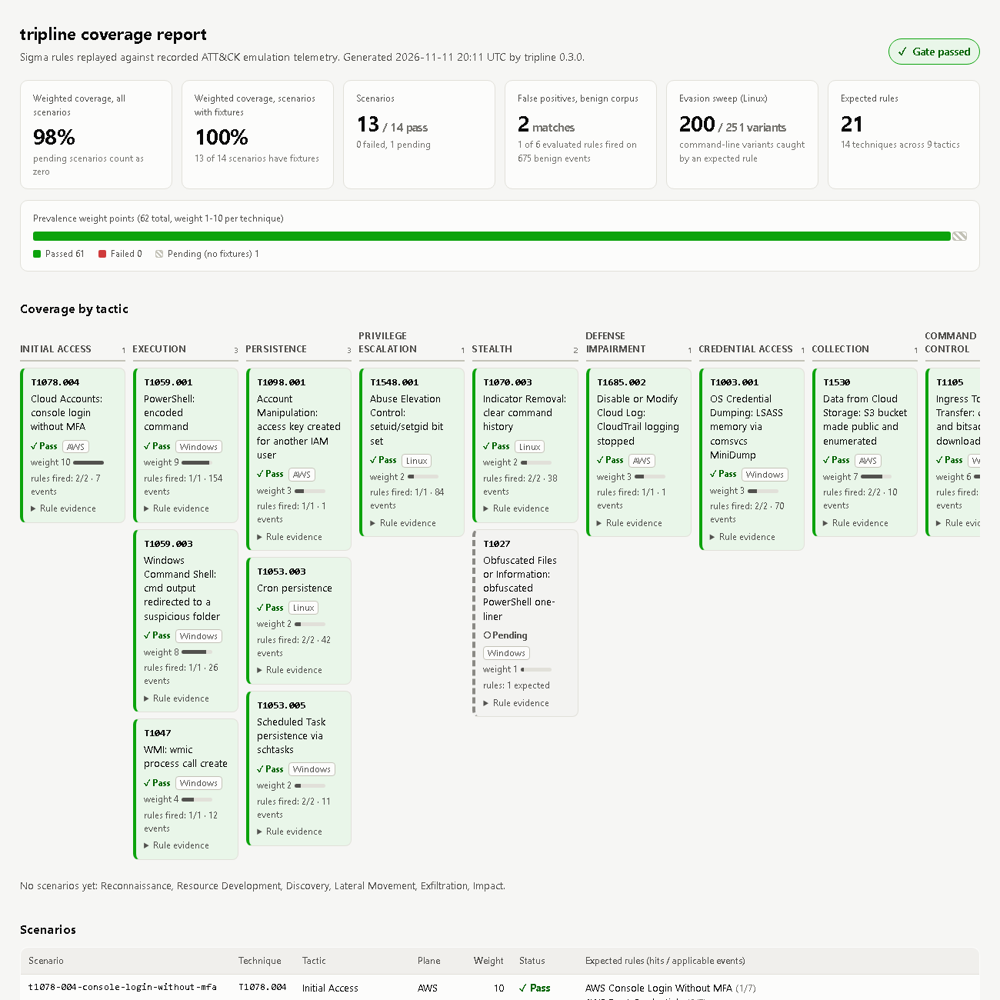
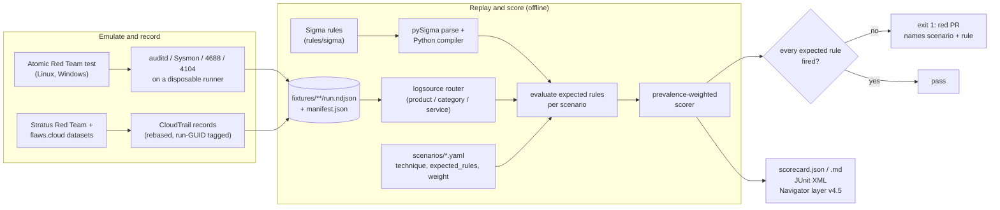
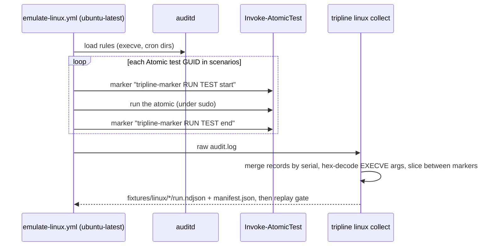

# tripline

[](https://github.com/samiali38183/tripline/actions/workflows/ci.yml)
[](LICENSE)

[](docs/scorecard.md)

tripline is a CI gate for Sigma detection rules. Each ATT&CK technique has recorded telemetry (auditd, Sysmon/Security/PowerShell, CloudTrail) committed in the repo. On every pull request tripline replays that telemetry through the rules and fails the build if a rule that should fire on the technique does not. It also reports prevalence-weighted coverage, false positives on a benign corpus and a first sweep of evasion variants.

It has already found a real gap. The stock SigmaHQ *Setuid and Setgid* rule flagged 0 of the 2 attack events (the two `chmod` executions) among the 36 events I recorded from Atomic Red Team's own T1548.001 tests. A replacement rule flags 2 of 2 ([finding F-001](docs/findings.md)).

| | |
|---|---|
| Scenarios | 14 ATT&CK techniques: 4 AWS (public replay), 3 Linux, 7 Windows (recorded on runners) |
| Gate today | 13 of 14 scenarios pass (AWS 4/4, Linux 3/3, Windows 6/7). One Windows scenario is pending. |
| Weighted coverage | 98% of weight points have a passing scenario (61 of 62). Only 52% (32 of 62, 8 scenarios) pass on unmodified SigmaHQ rules alone. The other 5 passing scenarios (29 points) need at least one rule I wrote. 45 of the 62 points follow a published ranking and 17 are hand-assigned ([weights](docs/weights.md)). |
| False positives | 2 matches from 1 of 6 evaluated rules on a 675-event benign Linux corpus. The other 20 of 26 rules were not evaluated ([benign corpus](docs/benign-corpus.md)). |
| Evasion sweep | 200 of 251 command-line variants of the three Linux attacks are caught by an expected rule ([robustness](docs/robustness.md)). |
| Gaps found | SigmaHQ *Setuid and Setgid* missed both attack events ([F-001](docs/findings.md)). Three Windows rules missed their Atomic tests ([F-003](docs/findings.md)). |
| Code | 212 tests, 91% coverage, ruff and mypy (strict) clean, ATT&CK v20 ([version notes](docs/attack-version.md)) |

Try it (Python 3.12+, no SIEM, offline, about a second):

```bash
git clone https://github.com/samiali38183/tripline && cd tripline
python -m venv .venv && . .venv/bin/activate        # Windows: .venv\Scripts\activate
pip install -e ".[dev]" && tripline replay --all    # exit 1 if an expected rule misses
```

[](docs/report.html)

The screenshot is `tripline report` run on the committed scorecard. It shows an ATT&CK-style matrix by tactic (ATT&CK v20 names), colored by pass, fail or pending, with each scenario's weight and per-rule hit counts, plus the benign-corpus and evasion tables. The report is one self-contained HTML file ([`docs/report.html`](docs/report.html)). [`pages.yml`](.github/workflows/pages.yml) rebuilds it and publishes it to GitHub Pages from `main`.

Related tools: SigmaHQ's [regression tests](https://github.com/SigmaHQ/sigma/tree/master/regression_data) and [rsigma `backtest`](https://rsigma.io/cli/rule/backtest/) also replay samples against rules in CI. SCYTHE's [pipeline](https://scythe.io/sigma) runs Atomic tests against a live Splunk, and Splunk's [attack_data](https://github.com/splunk/attack_data) publishes recorded Atomic telemetry. tripline does not replace any of them. What I added is a small scenario layer (technique, expected rules, fixture and weight in one repo), an evaluator in plain Python that runs on a stock runner, an ATT&CK-weighted scorecard, and the findings I wrote up, such as the setuid gap. It evaluates rules with its own compiler instead of a real SIEM backend, and it covers 14 techniques ([comparison](docs/related-work.md)).

## The problem

Detection teams usually track how many rules they have and which ATT&CK techniques those rules are tagged with. Neither number says whether a rule still fires on the behavior it is named after, or how often it fires on normal work. Rules break quietly. A modifier gets edited, an upstream rule changes, a field name drifts, or the rule never matched the real command line in the first place. `sigma check` passes all of these.

tripline treats a detection like code under test. A scenario (`scenarios/*.yaml`) names a technique, how it is emulated, which Sigma rules must fire, and a prevalence weight. Recorded telemetry from the emulation is committed as a fixture. CI replays the fixture through the rules and exits non-zero if an expected rule misses. Separately, every rule is replayed over a benign corpus and over generated variants of the attack commands, and the counts go in the scorecard.

## Current results

Everything below was produced by the commands in [Quick start](#quick-start) on 2026-11-13.

| Plane | Telemetry | Scenarios passing | Where the fixtures come from |
|---|---|---|---|
| AWS | CloudTrail | 4 / 4 | Public replay: Stratus Red Team's published detonation logs and the flaws.cloud CloudTrail dataset, re-timestamped. I recorded nothing here. |
| Linux | auditd (execve + cron watches) | 3 / 3 | Recorded with Atomic Red Team on a GitHub-hosted `ubuntu-latest` runner |
| Windows | Sysmon / Security / PowerShell | 6 / 7 (1 pending) | Recorded with Atomic Red Team on a GitHub-hosted `windows-latest` runner: T1003.001, T1047 and T1105 from [run 42917025570](https://github.com/samiali38183/tripline/actions/runs/42917025570), and T1059.001, T1059.003 and T1053.005 from [run 43090565998](https://github.com/samiali38183/tripline/actions/runs/43090565998) |

- Weighted coverage is 98% of weight points with a passing scenario (61 of 62, counting the pending scenario as zero). Only 52% (32 of 62) pass on unmodified SigmaHQ rules. Eight scenarios pass on vendored rules only. Five need a rule written here: the custom AWS rules (T1078.004, T1530), the setuid replacement (T1548.001) and the two Windows replacements (T1059.003, T1053.005). `tripline score` works out the split from each expected rule's author field. Two of the Windows passes rest on my replacement rules and one on a narrowed scenario, not on the vendored SigmaHQ rule. See [F-003](docs/findings.md).
- `tripline replay --all` prints one line per scenario (13 PASS, 1 PENDING) and ends with `gate passed`. `tripline score` reports the same split as 13 passed, 0 failed, 1 pending. 26 rules compile, 21 of them expected by a scenario.
- False positives: 2 matches from 1 of 6 evaluated rules (SigmaHQ *New Cron File Created*, on a `chkrootkit` package install) over 675 benign events from one 33-second runner recording. The 20 Windows and AWS rules have no benign corpus and were not evaluated.
- Evasion sweep: for the three Linux scenarios, 200 of 251 command-line variants are caught by at least one expected rule (setuid 106/108, history clearing 71/103, cron 23/40). The 4 alternative-tool variants are all missed. I wrote the variant lists by hand and they are not exhaustive.
- Test suite: 212 tests, 91% coverage. `ruff format`, `ruff check`, `mypy` (strict), `sigma check rules/` (0 issues), `actionlint` and `zizmor` are clean.
- The scorecard also exports an ATT&CK Navigator layer (layer format 4.5, ATT&CK v20): [`docs/navigator_layer.json`](docs/navigator_layer.json). The other outputs are [`docs/scorecard.md`](docs/scorecard.md), [`docs/scorecard.json`](docs/scorecard.json), the HTML report [`docs/report.html`](docs/report.html) and the badge [`docs/coverage.svg`](docs/coverage.svg).

### The setuid gap

On the first Linux recording, the vendored SigmaHQ rule `c21c4eaa` (*Setuid and Setgid*) flagged 0 of the 2 attack events. All 36 recorded events apply to the rule. Two are the attack itself (the two `chmod` executions), 4 are `sudo`/`dash` wrapper lines that mention `chmod`, and 30 are unrelated. The rule looks for the literal text ` chmod u+s`, and the Atomic test ran `chmod u+xs`. `chmod 4755`, `chmod ug+s` or `chmod a+s` would be missed the same way.

The emulation run that recorded it ([run 41838714456](https://github.com/samiali38183/tripline/actions/runs/41838714456)) failed its own gate for exactly this reason. The repo now includes a replacement rule, `tripline_lnx_chmod_setuid_setgid_any_form.yml`. It anchors on the `chmod` binary and matches symbolic forms and octal modes that set the setuid or setgid bit, and it catches 2 of 2 (the two `chmod` executions). The 36 below is the whole recorded event count. The denominator that matters is the 2 attack events.

```
Setuid and Setgid                                  applicable 36  matched 0
Setuid or Setgid Bit Set via Chmod (Any Mode Form) applicable 36  matched 2
```

A second finding (F-002) was a bug in my own auditd collector: SYSCALL `a0..a3` register values were being hex-decoded into command lines. It is fixed and has a regression test. Full write-ups are in [`docs/findings.md`](docs/findings.md).

## How it works



1. Scenarios (`scenarios/*.yaml`, checked by a strict pydantic schema) hold the technique, tactic, emulation (real Atomic test GUIDs or a replay source), expected rule UUIDs, fixtures and weight.
2. The compiler (`tripline/engine/compiler.py`) lets pySigma parse the rule and apply value modifiers. tripline then walks the condition tree and turns each leaf into a closure over an event. It supports `contains`/`startswith`/`endswith`/`all`, `re` with flags, `windash`, `base64offset`, `cidr`, `fieldref`, `exists`, null, numeric comparisons, wildcards, `and`/`or`/`not`, `1 of`/`all of` and keywords. Anything else raises.
3. The logsource router (`tripline/logsource.py`) classifies each event (Sysmon event ID to category, PowerShell 4103/4104, auditd record type, CloudTrail) and maps collector shapes onto the field names Sigma rules expect. A rule is only evaluated on events its `logsource` matches.
4. Replay and scoring (`tripline/replay.py`, `tripline/scorer.py`) give per-rule hit counts as `N/M applicable events`, per-scenario pass or fail, and per-technique weighted coverage.
5. Outputs are `scorecard.json`, JUnit XML, Markdown (posted as a PR comment by CI), the Navigator layer, and a static HTML report with an SVG badge (`tripline/report.py`, no JavaScript, no CDN).

### Telemetry capture



The marker commands are ordinary `execve` events, so the attribution lives inside the audit log itself. On the cloud side there is no live AWS account. `tripline cloud build` selects real CloudTrail records with a short Python predicate you can read, shifts `eventTime` while keeping the offsets, and appends `tripline/<run-guid>` to `userAgent` (the same attribution trick Grimoire uses). Provenance for every fixture is in [`fixtures/cloud/SOURCES.md`](fixtures/cloud/SOURCES.md) and in each `manifest.json`.

## Design decisions

I compile Sigma to Python instead of requiring a SIEM, because the gate has to run on a plain GitHub runner for every PR and on a laptop. Walking pySigma's parsed condition tree, rather than re-parsing the rule YAML, leaves modifier semantics in the library and puts only evaluation in tripline. The cost is that this is a different evaluator from your production backend. See Limitations.

If the compiler cannot evaluate something, it raises. `UnsupportedRuleError` covers aggregations, `near`, placeholders and backend query expressions, and a scenario whose expected rule is missing or failed to compile counts as failed. A gate that cannot evaluate a rule should not pass it.

Results count only applicable events. A rule is evaluated only on events its logsource matches, and the output reads `1/7 applicable events`. A rule with no applicable events at all is reported as a routing problem (`no applicable events`, usually the wrong product, category or service). `0/7 applicable events (rule did not match)` is a real miss. These are separate outcomes in `scorecard.json` (`outcome`), the CLI, the JUnit file and the HTML report.

Coverage is weighted by technique prevalence: `sum(weight x coverage) / sum(weight)`. For the seven scenario techniques in Red Canary's published 2026 top 10, the weight is 11 minus the rank. That is 45 of 62 points, checked against the public chart on 2026-11-11. The other seven weights are low hand-assigned values with no source ([`docs/weights.md`](docs/weights.md)). Breaking T1078.004 (weight 10) moves the headline number more than breaking T1027 (weight 1). [`docs/gate-proof.md`](docs/gate-proof.md) records a PR where one edited line dropped weighted coverage from 37% to 21% and turned CI red. Pending scenarios count as zero, so scenarios without evidence cannot inflate the number.

I replace vendored rules instead of patching them. The SigmaHQ rule stays byte-for-byte (DRL 1.1, attribution header) and the scenario expects a separate tripline rule. If upstream fixes the rule, `tripline replay` picks that up without a merge conflict.

Fixtures are recorded by the workflows and committed by hand. The emulation workflows have `permissions: contents: read`, upload an artifact and never commit. I read the artifact first. A `recorded` fixture must name its source URL, and tests check each fixture against its manifest (event count and run GUID).

Field mapping is plain Python, not config. An event shape the router does not understand gets no logsource and is never evaluated, so it cannot match by accident.

The gate itself is a test. `tests/test_cli.py::test_replay_gate_fails_and_names_scenario` edits a copied repo the way [PR #1](https://github.com/samiali38183/tripline/pull/1) did and asserts exit 1.

The threat model for the pipeline (fixture tampering, upstream supply chain, workflow hijack) is in [`docs/threat-model.md`](docs/threat-model.md).

## Quick start

Requires Python 3.12+.

```bash
git clone https://github.com/samiali38183/tripline && cd tripline
python -m venv .venv && . .venv/bin/activate        # Windows: .venv\Scripts\activate
pip install -e ".[dev]"                             # use "." if you only need the CLI

tripline validate                                   # scenarios, rules, fixtures consistent?
tripline replay --all                               # the gate: exit 1 if an expected rule misses
tripline replay t1548-001-setuid-setgid --show-events
tripline score -o docs/scorecard.json --junit junit.xml --markdown scorecard.md
tripline heatmap docs/scorecard.json -o docs/navigator_layer.json   # ATT&CK Navigator layer v4.5
tripline docs docs/scorecard.json                                   # Markdown scorecard page
tripline report docs/scorecard.json --html report.html --badge coverage.svg   # HTML matrix + badge
tripline atomics linux                              # Atomic test GUIDs the Linux workflow runs
tripline benign                                     # replay all rules over fixtures/benign: false positives
tripline robustness --markdown docs/robustness.md   # evasion-variant sweep for the Linux scenarios
```

The checks CI runs: `ruff format --check tripline tests`, `ruff check tripline tests`, `mypy tripline`, `pytest --cov=tripline`, `sigma check rules/`, `tripline replay --all` and `zizmor --offline --persona auditor .github`. I also run `actionlint` locally.

To rebuild the cloud fixtures from the public datasets, run `tripline cloud build`. It downloads about 250 MB into `.cache/`. Do not run the Atomic tests on a workstation; see [`SECURITY.md`](SECURITY.md).

To add a detection to the gate, put the Sigma rule in `rules/sigma/<plane>/`. Then add or edit a scenario in `scenarios/` that lists its UUID under `expected_rules` and points at a fixture, and run `tripline validate && tripline replay --all`. CI does the same on the pull request and posts the scorecard as a comment.

## Example output

`tripline replay --all` (Linux and AWS scenarios shown; the Windows scenarios and the pending one print in the same format):

```
[   PASS] t1053-003-cron-persistence (T1053.003, linux) - 42 events
     + 6b14bac8-3e3a-4324-8109-42f0546a347f  Scheduled Cron Task/Job - Linux  (1/26 applicable events)
     + 6c4e2f43-d94d-4ead-b64d-97e53fa2bd05  New Cron File Created  (1/3 applicable events)
[   PASS] t1070-003-clear-command-history (T1070.003, linux) - 38 events
     + fdc88d25-96fb-4b7c-9633-c0e417fdbd4e  Linux Command History Tampering  (3/28 applicable events)
     + 1182f3b3-e716-4efa-99ab-d2685d04360f  History File Deletion  (1/26 applicable events)
[   PASS] t1078-004-console-login-without-mfa (T1078.004, aws) - 7 events
     + 3b1f0d2e-7c4a-4d5b-9e8f-2a6c1d0b9f41  AWS Console Login Without MFA  (1/7 applicable events)
     + 8ad1600d-e9dc-4251-b0ee-a65268f29add  AWS Root Credentials  (6/7 applicable events)
[   PASS] t1098-001-iam-backdoor-access-key (T1098.001, aws) - 1 events
     + 0a5177f4-6ca9-44c2-aacf-d3f3d8b6e4d2  AWS IAM Backdoor Users Keys  (1/1 applicable events)
[   PASS] t1530-s3-bucket-exposure (T1530, aws) - 10 events
     + 8f6a2c41-5d7e-4b0a-a3c9-1e2f3d4c5b6a  AWS S3 Bucket Made Public via ACL or Bucket Policy  (6/10 applicable events)
     + 5c0d9e7b-3a21-4f68-b8d4-7e9f0a1b2c3d  AWS S3 Bucket Enumeration by IAM User from Non-AWS Tooling  (4/10 applicable events)
[   PASS] t1548-001-setuid-setgid (T1548.001, linux) - 84 events
     + 7f3c2b1a-6d4e-4a9b-9c8d-1e2f3a4b5c6d  Setuid or Setgid Bit Set via Chmod (Any Mode Form)  (2/36 applicable events)
[   PASS] t1562-008-cloudtrail-stop (T1685.002, aws) - 1 events
     + 4db60cc0-36fb-42b7-9b58-a5b53019fb74  AWS CloudTrail Important Change  (1/1 applicable events)
gate passed
```

Here is the gate failing. In a scratch copy of the repo I changed one value in the MFA rule (`MFAUsed: 'No'` to `'Maybe'`), which still passes `sigma check`:

```
[   FAIL] t1078-004-console-login-without-mfa (T1078.004, aws) - 7 events
     - 3b1f0d2e-7c4a-4d5b-9e8f-2a6c1d0b9f41  AWS Console Login Without MFA  (0/7 applicable events (rule did not match))
GATE FAILED: 1 scenario(s) missed an expected rule: t1078-004-console-login-without-mfa
```

The exit code is 1.

## Scenarios

| Plane | Technique | Telemetry | Weight | Status |
|---|---|---|---|---|
| AWS | T1078.004 Cloud Accounts - console login without MFA | public replay (Stratus log + flaws.cloud) | 10 | pass |
| AWS | T1530 Data from Cloud Storage - S3 made public, enumerated | public replay (flaws.cloud) | 7 | pass |
| AWS | T1685.002 Disable or Modify Cloud Log - CloudTrail StopLogging (T1562.008 before ATT&CK v19) | public replay (Stratus log) | 3 | pass |
| AWS | T1098.001 Additional Cloud Credentials - IAM backdoor key | public replay (Stratus log) | 3 | pass |
| Win | T1059.001 PowerShell - encoded command | recorded, ART `0d181431`, `a538de64` | 9 | pass |
| Win | T1059.003 Command Shell - suspicious output redirect | recorded, ART `d0eb3597`, `00682c9f` | 8 | pass (tripline rule) |
| Win | T1105 Ingress Tool Transfer - certutil / bitsadmin | recorded, ART `dd3b61dd`, `a1921cd3` | 6 | pass |
| Win | T1047 WMI - `wmic process call create` | recorded, ART `b3bdfc91` | 4 | pass |
| Win | T1027 Obfuscated PowerShell one-liner | ART `8b3f4ed6`, `6683baf0` recorded; expected rule matched 0 of 15 events | 1 | pending |
| Win | T1003.001 LSASS Memory - comsvcs MiniDump | recorded, ART `2536dee2` | 3 | pass |
| Win | T1053.005 Scheduled Task persistence | recorded, ART `42f53695` | 2 | pass (tripline rule) |
| Linux | T1053.003 Cron persistence | recorded, ART `078e69eb`, `435057fb` | 2 | pass |
| Linux | T1070.003 Clear Command History | recorded, ART `a934276e`, `b1251c35` | 2 | pass |
| Linux | T1548.001 Setuid / Setgid | recorded, ART `759055b3`, `db55f666` | 2 | pass |

26 rules compile. 20 are vendored unmodified from SigmaHQ (DRL 1.1) and 6 I wrote for this project (three AWS, two Windows, one Linux). Weight provenance is in [`docs/weights.md`](docs/weights.md). ART is the Atomic Red Team test GUID prefix.

## Using it on your own rules

If your rules live in a Git repo, this gives a PR a pass or fail on recorded technique telemetry as well as a syntax check. If you already use SigmaHQ regression data or rsigma, the overlap is large. What tripline adds is the scenario and weight layer and the scorecard outputs.

It can also triage an upstream rule before you adopt it: replay the rule against the technique it claims to cover. F-001 is a case where the answer was that it does not, on the standard atomic.

The Navigator layer shows only techniques with evidence, colored by weighted result, with known uncovered techniques in grey. It is not a tag-count heatmap.

To adapt it, replace the fixtures with telemetry recorded from your own hosts and point scenarios at your rules. The field mapping in `tripline/logsource.py` has to match your collector's schema. There is no generic ECS or OCSF mapping.

## Limitations

The full text is in [`docs/limitations.md`](docs/limitations.md). The short version:

- A pass is a recall check on one recording. A scenario passes when every expected rule fires on at least one event. The benign and evasion measurements are separate and narrow, and the gate does not use them.
- Coverage is small and I chose it. 14 techniques, against 600+ (sub-)techniques in ATT&CK Enterprise. The 98% is progress against this repo's own scenario list, weighted by prevalence, and says nothing about anyone's real coverage. Seven of the weights are hand-assigned. Only 52% of weight points pass on unmodified SigmaHQ rules.
- Three of the six Windows passes are conditional. T1059.003 and T1053.005 pass on my replacement rules, written for the gaps F-003 found (the vendored rules matched 0 events on the same recordings). T1059.001 passes on its encoded-command half only, because no automated atomic exercises the download-cradle half. T1027 stays pending.
- The cloud plane is replayed, not detonated. The records are real CloudTrail from public datasets, but the three cloud rules I wrote sit alongside fixtures from the same datasets. Those passes show the wiring works. They are not independent evidence that the rules generalize. The public datasets also lack S3 data events.
- False positives are measured on Linux only, on one 33-second recording on one runner image. A rule with zero matches there is not shown to be quiet in production.
- The evasion sweep is a first version: hand-written variant lists, event-level evaluation, Linux scenarios only. The misses (for example 32 of 103 history-clearing variants) are listed in [`docs/robustness.md`](docs/robustness.md) and [F-004](docs/findings.md). I have not fixed them all.
- Linux telemetry is narrow: auditd `execve` plus cron watches on a single-user runner VM, with tens of unrelated events recorded next to each atomic.
- The evaluator is not a production backend. There is no parity test against a real SIEM yet, so treat a tripline pass as necessary, not sufficient.
- Emulation workflows are not bit-reproducible, because Atomic Red Team, Sysmon and the runner image move. The committed fixtures pin one snapshot. Installers are fetched unpinned from upstream `master` ([threat model](docs/threat-model.md), T3).

## Roadmap

Not done yet:

- T1027 (and a download-cradle atomic for T1059.001) on recorded telemetry.
- Benign corpora for Windows and AWS, and a larger, longer Linux corpus.
- Evasion variants for the Windows and cloud scenarios.
- A parity test against a real backend (OpenSearch) for the Python evaluator.
- Signed provenance (`actions/attest-build-provenance`) for fixture artifacts.

## Repository layout

```
scenarios/        ATT&CK scenario definitions (14)
rules/sigma/      Sigma rules by plane (vendored SigmaHQ + tripline_*), DRL 1.1 attribution
fixtures/         recorded NDJSON telemetry + manifest.json (aws, linux, windows, benign)
tripline/         CLI, compiler, router, replay, scorer, heatmap, collectors
scripts/windows/  winlog NDJSON exporter used by the Windows workflow
tests/            212 tests
docs/             findings, limitations, threat model, gate proof, committed scorecard, layer,
                  HTML report, badge
.github/workflows ci.yml (lint/types/tests + gate), pages.yml (HTML report to Pages),
                  emulate-linux.yml, emulate-windows.yml
```

## License

MIT for the code. The SigmaHQ rules included here are under the Detection Rule License 1.1 ([`rules/sigma/LICENSE-DRL.md`](rules/sigma/LICENSE-DRL.md)).
