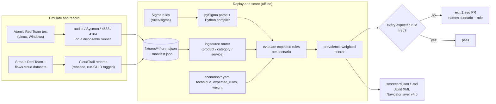
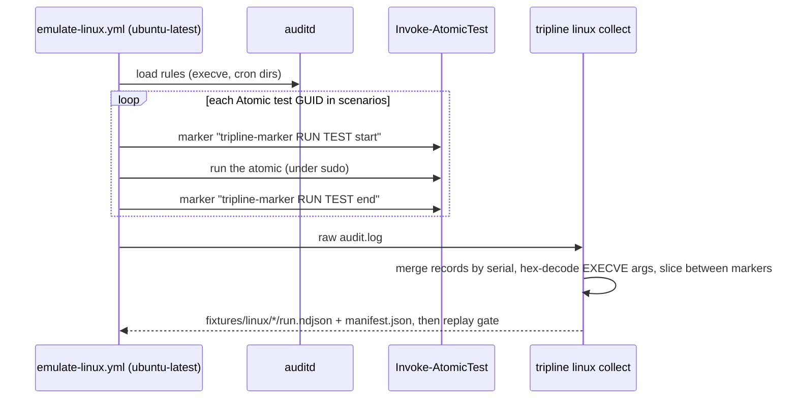

# tripline

[](https://github.com/samiali38183/tripline/actions/workflows/ci.yml)
[](LICENSE)

[](docs/scorecard.md)

tripline is a small, self-contained CI gate for Sigma detection rules. It replays recorded
telemetry (auditd, Sysmon/Security/PowerShell, CloudTrail) through the rules on every pull
request, fails the build when a rule that is supposed to fire on a technique does not, and reports
prevalence-weighted coverage, false positives on a benign corpus and a first evasion-variant sweep.

It is not the first tool that tests detections against recorded or generated telemetry.
SigmaHQ's own [regression tests](https://github.com/SigmaHQ/sigma/tree/master/regression_data)
replay EVTX/JSON samples against rules in CI, [rsigma `backtest`](https://rsigma.io/cli/rule/backtest/)
replays a corpus against per-rule expectations and flags unexpected fires, SCYTHE's
[pipeline](https://scythe.io/sigma) runs Atomic Red Team tests and queries a live Splunk, and Splunk's
[attack_data](https://github.com/splunk/attack_data) publishes recorded Atomic telemetry. What
tripline adds is a small scenario layer on top of the same idea: a technique, the rules expected to
catch it and the recorded fixture live in one repo, the evaluator is plain Python that runs offline
on a stock runner, the output is an ATT&CK-weighted scorecard, and it publishes what it finds, such
as the setuid rule gap below. What it does not do: it evaluates rules with its own compiler rather than
a production backend, it covers 14 techniques, and it is not a substitute for any of the tools above
([comparison](docs/related-work.md)).

| | |
|---|---|
| Scenarios | 14 ATT&CK techniques: 4 AWS (public replay), 3 Linux, 7 Windows (recorded on runners) |
| Gate today | 13 of 14 scenarios pass (AWS 4/4, Linux 3/3, Windows 6/7); 1 Windows scenario pending |
| Weighted coverage | 98% of weight points have a passing scenario (61 of 62); **52% of weight points (32 of 62, 8 scenarios) pass on unmodified SigmaHQ rules alone**, the other 5 passing scenarios (29 points) need at least one rule written for this project. 45 of the 62 points follow a published ranking, 17 are hand-assigned ([weights](docs/weights.md)) |
| False positives | 2 matches from 1 of 6 evaluated rules on a 675-event benign Linux corpus; 20 of 26 rules not evaluated ([benign corpus](docs/benign-corpus.md)) |
| Evasion sweep | 200 of 251 command-line variants of the three Linux attacks caught by an expected rule ([robustness](docs/robustness.md)) |
| Gaps found | SigmaHQ *Setuid and Setgid* matched 0 of 36 Atomic events ([F-001](docs/findings.md)); 3 Windows rules that miss their Atomic tests ([F-003](docs/findings.md)) |
| Code | 212 tests, 91% coverage, ruff and mypy strict clean, ATT&CK v20 ([version notes](docs/attack-version.md)) |

[](docs/report.html)

The report above is `tripline report` run on the committed scorecard: an ATT&CK-style matrix by
tactic (ATT&CK v20 names), colored by pass/fail/pending, with prevalence weight, per-rule hit counts,
the benign-corpus table and the evasion table. It is one self-contained HTML file
([`docs/report.html`](docs/report.html)), and [`pages.yml`](.github/workflows/pages.yml) rebuilds and
publishes it to GitHub Pages from `main`.

It already caught a real gap: the stock SigmaHQ *Setuid and Setgid* rule matched 0 of 36
events recorded from Atomic Red Team's own T1548.001 tests. A replacement rule matches 2 of 36
([finding F-001](docs/findings.md)).

No SIEM is required. Rules are compiled to Python predicates and evaluated against NDJSON
fixtures committed to the repo, so `tripline replay --all` is deterministic and runs offline in
a few seconds.

## Contents

[The problem](#the-problem) · [Current results](#current-results) · [How it works](#how-it-works) ·
[Engineering decisions](#engineering-decisions) · [Quick start](#quick-start) ·
[Example output](#example-output) · [Scenarios](#scenarios) · [Real-world use](#real-world-applicability) ·
[Limitations](#limitations) · [Roadmap](#roadmap)

## The problem

Detection teams track how many rules they have and which ATT&CK techniques those rules are tagged
with. Neither number says whether a rule still fires on the behaviour it is named after, or how
often it fires on normal work. Rules break quietly: a modifier is edited, an upstream rule changes,
a field name drifts, or the rule never matched the real command line in the first place. A syntax
linter (`sigma check`) will pass all of these.

tripline treats a detection like code under test. A *scenario* (`scenarios/*.yaml`) declares a
technique, how it is emulated, which Sigma rules must fire, and a prevalence weight. Recorded
telemetry from that emulation is committed as a fixture. CI replays the fixture through the
rules and exits non-zero if an expected rule misses. Separately, every rule is replayed over a benign
corpus and over generated variants of the attack commands, and the counts are reported.

## Current results

All figures were produced by the commands in [Quick start](#quick-start) on 2026-11-11.

| Plane | Telemetry | Scenarios passing | Source of the fixtures |
|---|---|---|---|
| AWS | CloudTrail | **4 / 4** | **Public replay**: Stratus Red Team's published detonation logs and the flaws.cloud CloudTrail dataset, re-timestamped; nothing was recorded by this project |
| Linux | auditd (execve + cron watches) | **3 / 3** | **Recorded** with Atomic Red Team on a GitHub-hosted `ubuntu-latest` runner |
| Windows | Sysmon / Security / PowerShell | **6 / 7** (1 pending) | **Recorded** with Atomic Red Team on a GitHub-hosted `windows-latest` runner: T1003.001, T1047, T1105 from [run 42917025570](https://github.com/samiali38183/tripline/actions/runs/42917025570); T1059.001, T1059.003, T1053.005 from [run 43090565998](https://github.com/samiali38183/tripline/actions/runs/43090565998) |

- **Prevalence-weighted coverage: 98% of weight points have a passing scenario (61 of 62; the
  pending scenario counts as zero), but only 52% (32 of 62) pass on unmodified SigmaHQ rules alone.**
  Eight scenarios pass on vendored rules only; five need a rule written here: the custom AWS
  rules (T1078.004, T1530), the setuid replacement (T1548.001) and the two Windows replacements
  (T1059.003, T1053.005). `tripline score` computes the split from each expected rule's author field. Two of the Windows
  passes rest on tripline replacement rules and one on a narrowed scenario, not on the vendored
  SigmaHQ rule: see [F-003](docs/findings.md).
- `tripline replay --all`: 13 passed, 0 failed, 1 pending; 26 rules compiled, 21 expected rules.
- **False positives:** 2 matches from 1 of 6 evaluated rules (SigmaHQ *New Cron File Created* on a
  `chkrootkit` package install) over 675 benign events from one 33-second runner recording; the 20
  Windows and AWS rules have no benign corpus and were not evaluated.
- **Evasion sweep:** for the three Linux scenarios, 200 of 251 command-line variants are caught by
  at least one expected rule (setuid 106/108, history clearing 71/103, cron 23/40); alternative
  tools 0 of 4. The variant lists are hand-written and not exhaustive.
- Test suite: **212 tests, 91% coverage**. `ruff format`, `ruff check`, `mypy` (strict),
  `sigma check rules/` (0 issues), `actionlint` and `zizmor` are clean.
- The scorecard also exports an ATT&CK Navigator layer (layer format 4.5, ATT&CK v20):
  [`docs/navigator_layer.json`](docs/navigator_layer.json), plus
  [`docs/scorecard.md`](docs/scorecard.md), [`docs/scorecard.json`](docs/scorecard.json), the HTML
  report [`docs/report.html`](docs/report.html) and the badge [`docs/coverage.svg`](docs/coverage.svg).

### What it caught

On the first Linux recording the vendored SigmaHQ rule `c21c4eaa` *Setuid and Setgid* matched
**0 of 36** applicable events. It looks for the literal text ` chmod u+s`; the Atomic test ran
`chmod u+xs`, and `chmod 4755`, `chmod ug+s` or `chmod a+s` would be missed the same way. The
emulation run that recorded it ([run 41838714456](https://github.com/samiali38183/tripline/actions/runs/41838714456))
failed its own gate for exactly this reason. The repo includes a replacement rule,
`tripline_lnx_chmod_setuid_setgid_any_form.yml`, that anchors on the `chmod` binary and matches
symbolic forms and octal modes with the setuid or setgid bit set: **2 of 36**, the two `chmod`
executions. Reproduced:

```
Setuid and Setgid                                  applicable 36  matched 0
Setuid or Setgid Bit Set via Chmod (Any Mode Form) applicable 36  matched 2
```

A second finding (F-002) was a bug in tripline's own auditd collector: SYSCALL `a0..a3` register
values were being hex-decoded into command lines. It is fixed and has a regression test.
Full write-ups: [`docs/findings.md`](docs/findings.md).

## How it works



1. **Scenarios** (`scenarios/*.yaml`, validated by a strict pydantic schema): technique, tactic,
   emulation (real Atomic test GUIDs or a replay source), expected rule UUIDs, fixtures, weight.
2. **Compiler** (`tripline/engine/compiler.py`): pySigma parses the rule and applies value
   modifiers; tripline walks the resulting condition tree and turns each leaf into a closure over
   an event. Supported: `contains`/`startswith`/`endswith`/`all`, `re` with flags, `windash`,
   `base64offset`, `cidr`, `fieldref`, `exists`, null, numeric comparisons, wildcards,
   `and`/`or`/`not`, `1 of`/`all of`, keywords. Anything else raises.
3. **Logsource router** (`tripline/logsource.py`): classifies each event (Sysmon event ID to
   category, PowerShell 4103/4104, auditd record type, CloudTrail) and folds collector shapes into
   the field names Sigma rules expect. A rule is only evaluated on events its `logsource` matches.
4. **Replay and scoring** (`tripline/replay.py`, `tripline/scorer.py`): per-rule hit counts
   reported as `N/M applicable events`, per-scenario pass/fail, per-technique weighted coverage.
5. **Outputs**: `scorecard.json`, JUnit XML, Markdown (posted as a PR comment by CI), Navigator
   layer, and a static HTML report plus SVG badge (`tripline/report.py`, no JavaScript, no CDN).

### Telemetry capture



The marker commands are ordinary `execve` events, so attribution lives inside the audit log
itself. On the cloud side there is no live AWS account: `tripline cloud build` selects real
CloudTrail records with a reviewable Python predicate, shifts `eventTime` while preserving
offsets, and appends `tripline/<run-guid>` to `userAgent` (the same attribution trick Grimoire
uses). Provenance for every fixture is in [`fixtures/cloud/SOURCES.md`](fixtures/cloud/SOURCES.md)
and each `manifest.json`.

## Engineering decisions

- **Compile Sigma to Python instead of requiring a SIEM.** The gate must run on a plain GitHub
  runner for every PR and on a laptop. Walking pySigma's parsed condition tree (rather than
  re-parsing rule YAML) keeps modifier semantics in the library and puts only the evaluation in
  tripline. The cost is that this is a *different evaluator* from your production backend; see
  Limitations.
- **Unsupported means error, not "no match".** The compiler raises `UnsupportedRuleError` for
  aggregations, `near`, placeholders and backend query expressions, and a scenario whose expected
  rule is missing or failed to compile is a failed scenario. A gate that cannot evaluate a rule
  must not pass it.
- **Count only applicable events.** A rule is evaluated only on events its logsource matches, and
  results read `1/7 applicable events`. A rule with no applicable events at all is reported as a
  routing problem (`no applicable events`, wrong product/category/service), not as a missed
  detection; `0/7 applicable events (rule did not match)` is the real miss. The two are separate
  outcomes in `scorecard.json` (`outcome`), the CLI, the JUnit file and the HTML report.
- **Weight by technique prevalence.** Coverage is `sum(weight x coverage) / sum(weight)`. For the
  seven scenario techniques in Red Canary's published 2026 top 10 the weight is 11 minus the rank
  (45 of 62 points, checked against the public chart on 2026-11-11); the other seven weights are
  hand-assigned low values with no source ([`docs/weights.md`](docs/weights.md)). Breaking T1078.004
  (weight 10) moves the headline number more than breaking T1027 (weight 1).
  [`docs/gate-proof.md`](docs/gate-proof.md) records a PR where one edited line dropped weighted
  coverage from 37% to 21% and turned CI red. Pending scenarios count as zero in the headline so the
  number cannot be inflated by scenarios without evidence.
- **Replace, don't patch, vendored rules.** The SigmaHQ rule stays byte-for-byte (DRL 1.1,
  attribution header) and the scenario expects a separate tripline rule. If upstream fixes the
  rule, `tripline replay` picks that up without a merge conflict.
- **Fixtures are recorded and committed by a human.** The emulation workflows have
  `permissions: contents: read`, upload an artifact, and never auto-commit; a maintainer reads
  the artifact first. A `recorded` fixture must name its source URL, and tests check each fixture
  against its manifest (event count and run GUID).
- **Field mapping is code, not config.** The router is explicit Python so that an event shape no
  router understands gets no logsource and is never evaluated, instead of silently matching.
- **Gate proof as a test.** `tests/test_cli.py::test_replay_gate_fails_and_names_scenario`
  edits a copied repo the way [PR #1](https://github.com/samiali38183/tripline/pull/1) did and
  asserts exit 1.

The threat model for the pipeline itself (fixture tampering, upstream supply chain, workflow
hijack) is in [`docs/threat-model.md`](docs/threat-model.md).

## Quick start

Requires Python 3.12+.

```bash
git clone https://github.com/samiali38183/tripline && cd tripline
python -m venv .venv && . .venv/bin/activate        # Windows: .venv\Scripts\activate
pip install -e ".[dev]"                             # use "." if you only need the CLI

tripline validate                                   # scenarios, rules, fixtures consistent?
tripline replay --all                               # the gate: exit 1 if an expected rule misses
tripline replay t1548-001-setuid-setgid --show-events
tripline score -o docs/scorecard.json --junit junit.xml --markdown scorecard.md
tripline heatmap docs/scorecard.json -o docs/navigator_layer.json   # ATT&CK Navigator layer v4.5
tripline docs docs/scorecard.json                                   # Markdown scorecard page
tripline report docs/scorecard.json --html report.html --badge coverage.svg   # HTML matrix + badge
tripline atomics linux                              # Atomic test GUIDs the Linux workflow runs
tripline benign                                     # replay ALL rules over fixtures/benign: false positives
tripline robustness --markdown docs/robustness.md   # evasion-variant sweep for the Linux scenarios
```

Quality gates (same as CI): `ruff format --check tripline tests`, `ruff check tripline tests`,
`mypy tripline`, `pytest --cov=tripline`, `sigma check rules/`, `tripline replay --all`,
`actionlint` and `zizmor --offline --persona auditor .github`.

To rebuild the cloud fixtures from the public datasets, run `tripline cloud build` (about 450 MB
download into `.cache/`). Do **not** run the Atomic tests on a workstation; see
[`SECURITY.md`](SECURITY.md).

**Adding a detection to the gate:** drop the Sigma rule in `rules/sigma/<plane>/`, add or edit a
scenario in `scenarios/` that lists its UUID under `expected_rules` and points at a fixture, then
run `tripline validate && tripline replay --all`. CI does the same on the pull request and posts
the scorecard as a comment.

## Example output

`tripline replay --all` (Linux and AWS scenarios shown; the Windows scenarios and the one pending
scenario print in the same format):

```
[   PASS] t1053-003-cron-persistence (T1053.003, linux) - 42 events
     + 6b14bac8-3e3a-4324-8109-42f0546a347f  Scheduled Cron Task/Job - Linux  (1/26 applicable events)
     + 6c4e2f43-d94d-4ead-b64d-97e53fa2bd05  New Cron File Created  (1/3 applicable events)
[   PASS] t1070-003-clear-command-history (T1070.003, linux) - 38 events
     + fdc88d25-96fb-4b7c-9633-c0e417fdbd4e  Linux Command History Tampering  (3/28 applicable events)
     + 1182f3b3-e716-4efa-99ab-d2685d04360f  History File Deletion  (1/26 applicable events)
[   PASS] t1078-004-console-login-without-mfa (T1078.004, aws) - 7 events
     + 3b1f0d2e-7c4a-4d5b-9e8f-2a6c1d0b9f41  AWS Console Login Without MFA  (1/7 applicable events)
     + 8ad1600d-e9dc-4251-b0ee-a65268f29add  AWS Root Credentials  (6/7 applicable events)
[   PASS] t1098-001-iam-backdoor-access-key (T1098.001, aws) - 1 events
     + 0a5177f4-6ca9-44c2-aacf-d3f3d8b6e4d2  AWS IAM Backdoor Users Keys  (1/1 applicable events)
[   PASS] t1530-s3-bucket-exposure (T1530, aws) - 10 events
     + 8f6a2c41-5d7e-4b0a-a3c9-1e2f3d4c5b6a  AWS S3 Bucket Made Public via ACL or Bucket Policy  (6/10 applicable events)
     + 5c0d9e7b-3a21-4f68-b8d4-7e9f0a1b2c3d  AWS S3 Bucket Enumeration by IAM User from Non-AWS Tooling  (4/10 applicable events)
[   PASS] t1548-001-setuid-setgid (T1548.001, linux) - 84 events
     + 7f3c2b1a-6d4e-4a9b-9c8d-1e2f3a4b5c6d  Setuid or Setgid Bit Set via Chmod (Any Mode Form)  (2/36 applicable events)
[   PASS] t1562-008-cloudtrail-stop (T1685.002, aws) - 1 events
     + 4db60cc0-36fb-42b7-9b58-a5b53019fb74  AWS CloudTrail Important Change  (1/1 applicable events)
gate passed
```

And the gate failing. Changing one value in the MFA rule (`MFAUsed: 'No'` to `'Maybe'`, which
still passes `sigma check`) in a scratch copy of the repo:

```
[   FAIL] t1078-004-console-login-without-mfa (T1078.004, aws) - 7 events
     - 3b1f0d2e-7c4a-4d5b-9e8f-2a6c1d0b9f41  AWS Console Login Without MFA  (0/7 applicable events (rule did not match))
GATE FAILED: 1 scenario(s) missed an expected rule: t1078-004-console-login-without-mfa
```
(exit code 1)

## Scenarios

| Plane | Technique | Telemetry | Weight | Status |
|---|---|---|---|---|
| AWS | T1078.004 Cloud Accounts - console login without MFA | public replay (Stratus log + flaws.cloud) | 10 | pass |
| AWS | T1530 Data from Cloud Storage - S3 made public, enumerated | public replay (flaws.cloud) | 7 | pass |
| AWS | T1685.002 Disable or Modify Cloud Log - CloudTrail StopLogging (T1562.008 before ATT&CK v19) | public replay (Stratus log) | 3 | pass |
| AWS | T1098.001 Additional Cloud Credentials - IAM backdoor key | public replay (Stratus log) | 3 | pass |
| Win | T1059.001 PowerShell - encoded command | recorded, ART `0d181431`, `a538de64` | 9 | pass |
| Win | T1059.003 Command Shell - suspicious output redirect | recorded, ART `d0eb3597`, `00682c9f` | 8 | pass (tripline rule) |
| Win | T1105 Ingress Tool Transfer - certutil / bitsadmin | recorded, ART `dd3b61dd`, `a1921cd3` | 6 | pass |
| Win | T1047 WMI - `wmic process call create` | recorded, ART `b3bdfc91` | 4 | pass |
| Win | T1027 Obfuscated PowerShell one-liner | ART `8b3f4ed6`, `6683baf0` recorded; expected rule matched 0 of 15 events | 1 | pending |
| Win | T1003.001 LSASS Memory - comsvcs MiniDump | recorded, ART `2536dee2` | 3 | pass |
| Win | T1053.005 Scheduled Task persistence | recorded, ART `42f53695` | 2 | pass (tripline rule) |
| Linux | T1053.003 Cron persistence | recorded, ART `078e69eb`, `435057fb` | 2 | pass |
| Linux | T1070.003 Clear Command History | recorded, ART `a934276e`, `b1251c35` | 2 | pass |
| Linux | T1548.001 Setuid / Setgid | recorded, ART `759055b3`, `db55f666` | 2 | pass |

Rules: 26 compiled, of which 20 are vendored unmodified from SigmaHQ (DRL 1.1) and 6 are
authored for this project (three AWS, two Windows, one Linux). Weight provenance is in
[`docs/weights.md`](docs/weights.md). ART = Atomic Red Team test GUID prefix.

## Real-world applicability

- **Detection-as-code pipelines.** If your rules live in a Git repo, this pattern gives a PR a
  pass/fail on recorded technique telemetry as well as a syntax check. If you already use SigmaHQ
  regression data or rsigma, tripline overlaps; its extra pieces are the scenario/weight layer and
  the scorecard outputs.
- **Upstream rule triage.** Before adopting a SigmaHQ rule, replay it against the technique it
  claims to cover. F-001 is an example where the answer was "it does not, on the standard
  atomic".
- **Coverage reporting.** The Navigator layer shows only techniques with evidence, coloured by
  weighted result, with explicitly-uncovered techniques in grey, instead of a tag-count heatmap.
- **Adapting it to your environment.** Replace the fixtures with telemetry recorded from your own
  hosts and point scenarios at your rules. The field mapping in `tripline/logsource.py` must match
  your collector's schema; there is no generic ECS/OCSF mapping.

## Limitations

Stated plainly so the numbers are read correctly (full text in
[`docs/limitations.md`](docs/limitations.md)):

- **A pass is a recall check on one recording.** A scenario passes when every expected rule fires
  on at least one event. The benign and evasion measurements are separate and narrow (below); the
  gate does not use them.
- **Small, project-chosen coverage.** 14 techniques; ATT&CK Enterprise has 600+ (sub-)techniques.
  The 98% is progress against this repo's own scenario list weighted by prevalence, not a claim
  about any organisation's coverage. Seven of the weights are hand-assigned.
  Only 52% of weight points pass on unmodified SigmaHQ rules alone; the rest need rules written here.
- **Three of the six Windows passes are conditional.** T1059.003 and T1053.005 pass on tripline
  replacement rules written for the gaps F-003 found (the vendored rules matched 0 events on
  the same recordings), and T1059.001 passes on its encoded-command half only (the download-cradle
  half was dropped because no automated atomic exercises it). T1027 stays pending.
- **The cloud plane is replayed, not detonated by this project.** The records are real
  CloudTrail from public datasets, but the three cloud rules written for this project sit
  alongside fixtures from the same datasets. Those passes show the wiring works; they are not
  independent evidence the rules generalise. Public datasets also lack S3 data events.
- **False positives are measured on Linux only**, on one 33-second recording on one runner
  image. A rule with zero matches there is not shown to be quiet in production.
- **The evasion sweep is a first version.** Hand-written variant lists, event-level evaluation,
  Linux scenarios only. Misses (for example 32 of 103 history-clearing variants) are documented in
  [`docs/robustness.md`](docs/robustness.md) and [F-004](docs/findings.md), not all fixed.
- **Linux telemetry is narrow.** auditd `execve` plus cron watches on a single-user runner VM,
  with 20-40 wrapper processes per atomic.
- **Different evaluator from production.** There is no parity test against a real SIEM backend
  yet. Treat a tripline pass as necessary, not sufficient.
- Emulation workflows are not bit-reproducible (Atomic Red Team, Sysmon and the runner image
  move); committed fixtures pin the snapshot. Installers are fetched unpinned from upstream
  `master` ([threat model](docs/threat-model.md), T3).

## Roadmap

Planned, not done:

- T1027 (and a download-cradle atomic for T1059.001) on recorded telemetry.
- Benign corpora for Windows and AWS; a larger and longer Linux corpus.
- Evasion variants for the Windows and cloud scenarios.
- Parity test against a real backend (OpenSearch) for the Python evaluator.
- Signed provenance (`actions/attest-build-provenance`) for fixture artifacts.

## Repository layout

```
scenarios/        ATT&CK scenario definitions (14)
rules/sigma/      Sigma rules by plane (vendored SigmaHQ + tripline_*), DRL 1.1 attribution
fixtures/         recorded NDJSON telemetry + manifest.json (aws, linux, windows, benign)
tripline/         CLI, compiler, router, replay, scorer, heatmap, collectors
scripts/windows/  winlog NDJSON exporter used by the Windows workflow
tests/            212 tests
docs/             findings, limitations, threat model, gate proof, committed scorecard, layer,
                  HTML report, badge
.github/workflows ci.yml (lint/types/tests + gate), pages.yml (HTML report to Pages),
                  emulate-linux.yml, emulate-windows.yml
```

## License

MIT for the code. The SigmaHQ rules included here are under the Detection Rule License 1.1
([`rules/sigma/LICENSE-DRL.md`](rules/sigma/LICENSE-DRL.md)).
