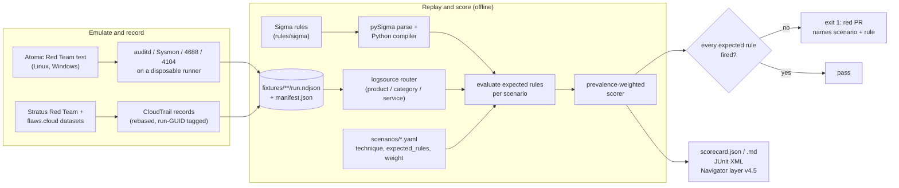
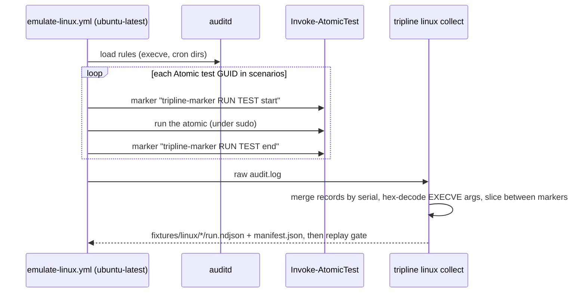

# tripline

[](https://github.com/samiali38183/tripline/actions/workflows/ci.yml)
[](LICENSE)

[](docs/scorecard.md)

tripline is a CI gate for detection rules. It replays recorded ATT&CK emulation telemetry
(auditd, CloudTrail) through Sigma rules on every pull request, fails the build when a rule that
is supposed to fire does not, and scores the result by how common each technique is in the wild.

| | |
|---|---|
| Scenarios | 14 ATT&CK techniques: 4 AWS, 3 Linux, 7 Windows |
| Gate today | 7 of 7 scenarios with fixtures pass (AWS 4/4, Linux 3/3); 7 Windows pending |
| Weighted coverage | 47% of all 14 scenarios (29 of 62 prevalence points) |
| Gaps found | SigmaHQ *Setuid and Setgid* matched 0 of 36 Atomic events ([F-001](docs/findings.md)); 3 Windows rules that miss their Atomic tests ([F-003](docs/findings.md)) |
| Code | 113 tests, 89% line+branch coverage, ruff and mypy strict clean |

[](docs/report.html)

The report above is `tripline report` run on the committed scorecard: an ATT&CK-style matrix by
tactic, colored by pass/fail/pending, with prevalence weight and per-rule hit counts. It is one
self-contained HTML file ([`docs/report.html`](docs/report.html)), and
[`pages.yml`](.github/workflows/pages.yml) rebuilds and publishes it to GitHub Pages from `main`.

It already caught a real gap: the stock SigmaHQ *Setuid and Setgid* rule matched 0 of 36
events recorded from Atomic Red Team's own T1548.001 tests. A replacement rule matches 2 of 36
([finding F-001](docs/findings.md)).

No SIEM is required. Rules are compiled to Python predicates and evaluated against NDJSON
fixtures committed to the repo, so `tripline replay --all` is deterministic and runs offline in
a few seconds.

## Contents

[The problem](#the-problem) · [Current results](#current-results) · [How it works](#how-it-works) ·
[Engineering decisions](#engineering-decisions) · [Quick start](#quick-start) ·
[Example output](#example-output) · [Scenarios](#scenarios) · [Real-world use](#real-world-applicability) ·
[Limitations](#limitations) · [Roadmap](#roadmap)

## The problem

Detection teams track how many rules they have and which ATT&CK techniques those rules are tagged
with. Neither number says whether a rule still fires on the behaviour it is named after.
Rules break quietly: a modifier is edited, an upstream rule changes, a field name drifts, or the
rule never matched the real command line in the first place. A syntax linter (`sigma check`) will
pass all of these.

tripline treats a detection like code under test. A *scenario* (`scenarios/*.yaml`) declares a
technique, how it is emulated, which Sigma rules must fire, and a prevalence weight. Recorded
telemetry from that emulation is committed as a fixture. CI replays the fixture through the
rules and exits non-zero if an expected rule misses.

## Current results

All figures below were reproduced from a clean checkout on 2026-11-10.

| Plane | Telemetry | Scenarios passing | Source of the fixtures |
|---|---|---|---|
| AWS | CloudTrail | **4 / 4** | Stratus Red Team detonation logs and the flaws.cloud CloudTrail dataset (public, replayed) |
| Linux | auditd (execve + cron watches) | **3 / 3** | Atomic Red Team on a GitHub-hosted `ubuntu-latest` runner |
| Windows | Sysmon / Security / PowerShell | **0 / 7 (pending)** | Workflow and collector exist; no fixtures committed. See [Limitations](#limitations) |

- **Prevalence-weighted coverage: 47% of all 14 scenarios, 100% of the scenarios that have
  fixtures** (29 of 62 weight points; pending scenarios count as zero in the headline figure).
- `tripline replay --all`: 7 passed, 0 failed, 7 pending; 24 rules compiled, 22 expected rules.
- Test suite: **113 tests, 89% line+branch coverage**. `ruff format`, `ruff check` and `mypy`
  (strict) are clean; `sigma check rules/` reports 0 errors and 1 medium tagging issue (see
  [Limitations](#limitations)).
- The scorecard also exports an ATT&CK Navigator layer (v4.5, ATT&CK v16):
  [`docs/navigator_layer.json`](docs/navigator_layer.json), plus
  [`docs/scorecard.md`](docs/scorecard.md), [`docs/scorecard.json`](docs/scorecard.json), the HTML
  report [`docs/report.html`](docs/report.html) and the badge [`docs/coverage.svg`](docs/coverage.svg).

### What it caught

On the first Linux recording the vendored SigmaHQ rule `c21c4eaa` *Setuid and Setgid* matched
**0 of 36** applicable events. It looks for the literal text ` chmod u+s`; the Atomic test ran
`chmod u+xs`, and `chmod 4755`, `chmod ug+s` or `chmod a+s` would be missed the same way. The
emulation run that recorded it ([run 41838714456](https://github.com/samiali38183/tripline/actions/runs/41838714456))
failed its own gate for exactly this reason. The fix is a new rule,
`tripline_lnx_chmod_setuid_setgid_any_form.yml`, that anchors on the `chmod` binary and matches
symbolic and 4-digit octal forms: **2 of 36**, the two `chmod` executions. Reproduced:

```
Setuid and Setgid                                  applicable 36  matched 0
Setuid or Setgid Bit Set via Chmod (Any Mode Form) applicable 36  matched 2
```

A second finding (F-002) was a bug in tripline's own auditd collector: SYSCALL `a0..a3` register
values were being hex-decoded into command lines. It is fixed and has a regression test.
Full write-ups: [`docs/findings.md`](docs/findings.md).

## How it works



1. **Scenarios** (`scenarios/*.yaml`, validated by a strict pydantic schema): technique, tactic,
   emulation (real Atomic test GUIDs or a replay source), expected rule UUIDs, fixtures, weight.
2. **Compiler** (`tripline/engine/compiler.py`): pySigma parses the rule and applies value
   modifiers; tripline walks the resulting condition tree and turns each leaf into a closure over
   an event. Supported: `contains`/`startswith`/`endswith`/`all`, `re` with flags, `windash`,
   `base64offset`, `cidr`, `fieldref`, `exists`, null, numeric comparisons, wildcards,
   `and`/`or`/`not`, `1 of`/`all of`, keywords. Anything else raises.
3. **Logsource router** (`tripline/logsource.py`): classifies each event (Sysmon event ID to
   category, PowerShell 4103/4104, auditd record type, CloudTrail) and folds collector shapes into
   the field names Sigma rules expect. A rule is only evaluated on events its `logsource` matches.
4. **Replay and scoring** (`tripline/replay.py`, `tripline/scorer.py`): per-rule hit counts
   reported as `N/M applicable events`, per-scenario pass/fail, per-technique weighted coverage.
5. **Outputs**: `scorecard.json`, JUnit XML, Markdown (posted as a PR comment by CI), Navigator
   layer, and a static HTML report plus SVG badge (`tripline/report.py`, no JavaScript, no CDN).

### Telemetry capture



The marker commands are ordinary `execve` events, so attribution lives inside the audit log
itself. On the cloud side there is no live AWS account: `tripline cloud build` selects real
CloudTrail records with a reviewable Python predicate, shifts `eventTime` while preserving
offsets, and appends `tripline/<run-guid>` to `userAgent` (the same attribution trick Grimoire
uses). Provenance for every fixture is in [`fixtures/cloud/SOURCES.md`](fixtures/cloud/SOURCES.md)
and each `manifest.json`.

## Engineering decisions

- **Compile Sigma to Python instead of requiring a SIEM.** The gate must run on a plain GitHub
  runner for every PR and on a laptop. Walking pySigma's parsed condition tree (rather than
  re-parsing rule YAML) keeps modifier semantics in the library and puts only the evaluation in
  tripline. The cost is that this is a *different evaluator* from your production backend; see
  Limitations.
- **Unsupported means error, not "no match".** The compiler raises `UnsupportedRuleError` for
  aggregations, `near`, placeholders and backend query expressions, and a scenario whose expected
  rule is missing or failed to compile is a failed scenario. A gate that cannot evaluate a rule
  must not pass it.
- **Count only applicable events.** A rule is evaluated only on events its logsource matches, and
  results read `1/7 applicable events`. A `0/0` line means a routing problem (wrong
  product/category/service), not a missed detection, and is visible on every run.
- **Weight by technique prevalence.** Coverage is `sum(weight x coverage) / sum(weight)` with
  weights 1-10 taken from the Red Canary 2026 Threat Detection Report ranking (mapped by hand in
  each scenario). Breaking T1078.004 (weight 10) moves the headline number more than breaking
  T1027 (weight 1). [`docs/gate-proof.md`](docs/gate-proof.md) records a PR where one edited
  line dropped weighted coverage from 37% to 21% and turned CI red. Pending scenarios count as
  zero in the headline so the number cannot be inflated by scenarios without evidence.
- **Replace, don't patch, vendored rules.** The SigmaHQ rule stays byte-for-byte (DRL 1.1,
  attribution header) and the scenario expects a separate tripline rule. If upstream fixes the
  rule, `tripline replay` picks that up without a merge conflict.
- **Fixtures are recorded and committed by a human.** The emulation workflows have
  `permissions: contents: read`, upload an artifact, and never auto-commit; a maintainer reads
  the artifact first. A `recorded` fixture must name its source URL, and tests check each fixture
  against its manifest (event count and run GUID).
- **Field mapping is code, not config.** The router is explicit Python so that an event shape no
  router understands gets no logsource and is never evaluated, instead of silently matching.
- **Gate proof as a test.** `tests/test_cli.py::test_replay_gate_fails_and_names_scenario`
  edits a copied repo the way [PR #1](https://github.com/samiali38183/tripline/pull/1) did and
  asserts exit 1.

The threat model for the pipeline itself (fixture tampering, upstream supply chain, workflow
hijack) is in [`docs/threat-model.md`](docs/threat-model.md).

## Quick start

Requires Python 3.12+.

```bash
git clone https://github.com/samiali38183/tripline && cd tripline
python -m venv .venv && . .venv/bin/activate        # Windows: .venv\Scripts\activate
pip install -e ".[dev]"                             # use "." if you only need the CLI

tripline validate                                   # scenarios, rules, fixtures consistent?
tripline replay --all                               # the gate: exit 1 if an expected rule misses
tripline replay t1548-001-setuid-setgid --show-events
tripline score -o docs/scorecard.json --junit junit.xml --markdown scorecard.md
tripline heatmap docs/scorecard.json -o docs/navigator_layer.json   # ATT&CK Navigator layer v4.5
tripline docs docs/scorecard.json                                   # Markdown scorecard page
tripline report docs/scorecard.json --html report.html --badge coverage.svg   # HTML matrix + badge
tripline atomics linux                              # Atomic test GUIDs the Linux workflow runs
```

Quality gates (same as CI): `ruff format --check tripline tests`, `ruff check tripline tests`,
`mypy tripline`, `pytest --cov=tripline`, `sigma check rules/`, `tripline replay --all`.

To rebuild the cloud fixtures from the public datasets, run `tripline cloud build` (about 450 MB
download into `.cache/`). Do **not** run the Atomic tests on a workstation; see
[`SECURITY.md`](SECURITY.md).

**Adding a detection to the gate:** drop the Sigma rule in `rules/sigma/<plane>/`, add or edit a
scenario in `scenarios/` that lists its UUID under `expected_rules` and points at a fixture, then
run `tripline validate && tripline replay --all`. CI does the same on the pull request and posts
the scorecard as a comment.

## Example output

`tripline replay --all` (Linux and AWS scenarios shown; the 7 Windows scenarios print as
`PENDING` with `0/0 applicable events`):

```
[   PASS] t1053-003-cron-persistence (T1053.003, linux) - 42 events
     + 6b14bac8-3e3a-4324-8109-42f0546a347f  Scheduled Cron Task/Job - Linux  (1/26 applicable events)
     + 6c4e2f43-d94d-4ead-b64d-97e53fa2bd05  New Cron File Created  (1/3 applicable events)
[   PASS] t1070-003-clear-command-history (T1070.003, linux) - 38 events
     + fdc88d25-96fb-4b7c-9633-c0e417fdbd4e  Linux Command History Tampering  (3/28 applicable events)
     + 1182f3b3-e716-4efa-99ab-d2685d04360f  History File Deletion  (1/26 applicable events)
[   PASS] t1078-004-console-login-without-mfa (T1078.004, aws) - 7 events
     + 3b1f0d2e-7c4a-4d5b-9e8f-2a6c1d0b9f41  AWS Console Login Without MFA  (1/7 applicable events)
     + 8ad1600d-e9dc-4251-b0ee-a65268f29add  AWS Root Credentials  (6/7 applicable events)
[   PASS] t1098-001-iam-backdoor-access-key (T1098.001, aws) - 1 events
     + 0a5177f4-6ca9-44c2-aacf-d3f3d8b6e4d2  AWS IAM Backdoor Users Keys  (1/1 applicable events)
[   PASS] t1530-s3-bucket-exposure (T1530, aws) - 10 events
     + 8f6a2c41-5d7e-4b0a-a3c9-1e2f3d4c5b6a  AWS S3 Bucket Made Public via ACL or Bucket Policy  (6/10 applicable events)
     + 5c0d9e7b-3a21-4f68-b8d4-7e9f0a1b2c3d  AWS S3 Bucket Enumeration by IAM User from Non-AWS Tooling  (4/10 applicable events)
[   PASS] t1548-001-setuid-setgid (T1548.001, linux) - 84 events
     + 7f3c2b1a-6d4e-4a9b-9c8d-1e2f3a4b5c6d  Setuid or Setgid Bit Set via Chmod (Any Mode Form)  (2/36 applicable events)
[   PASS] t1562-008-cloudtrail-stop (T1562.008, aws) - 1 events
     + 4db60cc0-36fb-42b7-9b58-a5b53019fb74  AWS CloudTrail Important Change  (1/1 applicable events)
gate passed
```

And the gate failing. Changing one value in the MFA rule (`MFAUsed: 'No'` to `'Maybe'`, which
still passes `sigma check`) in a scratch copy of the repo:

```
[   FAIL] t1078-004-console-login-without-mfa (T1078.004, aws) - 7 events
     - 3b1f0d2e-7c4a-4d5b-9e8f-2a6c1d0b9f41  AWS Console Login Without MFA  (0/7 applicable events)
GATE FAILED: 1 scenario(s) missed an expected rule: t1078-004-console-login-without-mfa
```
(exit code 1)

## Scenarios

| Plane | Technique | Emulation | Weight | Status |
|---|---|---|---|---|
| AWS | T1078.004 Cloud Accounts - console login without MFA | Stratus detonation + flaws.cloud replay | 10 | pass |
| AWS | T1530 Data from Cloud Storage - S3 made public, enumerated | flaws.cloud replay | 7 | pass |
| AWS | T1562.008 Impair Defenses - CloudTrail StopLogging | Stratus detonation replay | 3 | pass |
| AWS | T1098.001 Additional Cloud Credentials - IAM backdoor key | Stratus detonation replay | 3 | pass |
| Win | T1059.001 PowerShell - encoded command + download cradle | ART `0d181431`, `cc50fa2a` | 9 | pending |
| Win | T1059.003 Command Shell - suspicious output redirect | ART `d0eb3597`, `00682c9f` | 8 | pending |
| Win | T1105 Ingress Tool Transfer - certutil / bitsadmin | ART `dd3b61dd`, `a1921cd3` | 6 | pending |
| Win | T1047 WMI - `wmic process call create` | ART `b3bdfc91` | 4 | pending |
| Win | T1027 Obfuscated PowerShell one-liner | ART `8b3f4ed6`, `6683baf0` | 1 | pending |
| Win | T1003.001 LSASS Memory - comsvcs MiniDump | ART `2536dee2` | 3 | pending |
| Win | T1053.005 Scheduled Task persistence | ART `42f53695` | 2 | pending |
| Linux | T1053.003 Cron persistence | ART `078e69eb`, `435057fb` | 2 | pass |
| Linux | T1070.003 Clear Command History | ART `a934276e`, `b1251c35` | 2 | pass |
| Linux | T1548.001 Setuid / Setgid | ART `759055b3`, `db55f666` | 2 | pass |

Rules: 24 compiled, of which 20 are vendored unmodified from SigmaHQ (DRL 1.1) and 4 are written
for this project (three AWS, one Linux). Weight is the technique's rank in Red Canary's 2026
Threat Detection Report, mapped by hand (10 = most common). ART = Atomic Red Team test GUID prefix.

## Real-world applicability

- **Detection-as-code pipelines.** If your rules live in a Git repo, this pattern adds the
  missing test: a PR that edits a rule or its upstream gets a pass/fail on real technique
  telemetry, not just a syntax check.
- **Upstream rule triage.** Before adopting a SigmaHQ rule, replay it against the technique it
  claims to cover. F-001 is an example where the answer was "it does not, on the standard
  atomic".
- **Coverage reporting.** The Navigator layer shows only techniques with evidence, coloured by
  weighted result, with explicitly-uncovered techniques in grey, instead of a tag-count heatmap.
- **Adapting it to your environment.** Replace the fixtures with telemetry recorded from your own
  hosts and point scenarios at your rules. The field mapping in `tripline/logsource.py` must match
  your collector's schema; there is no generic ECS/OCSF mapping.

## Limitations

Stated plainly so the numbers are read correctly (full text in
[`docs/limitations.md`](docs/limitations.md)):

- **A pass is a recall check on one recording.** A scenario passes when every expected rule fires
  on at least one event. There is no benign corpus yet, so a rule that fires on everything also
  passes. There are no evasion variants yet, so robustness is untested beyond what F-001 showed.
- **Small, project-chosen coverage.** 14 techniques; ATT&CK Enterprise has 600+ (sub-)techniques.
  The 47% is progress against this repo's own scenario list weighted by prevalence, not a claim
  about any organisation's coverage.
- **Windows is not done.** No Windows fixtures are committed. The `emulate-windows` workflow
  has run three times on `windows-latest` and failed its gate each time. The latest
  ([run 42658659666](https://github.com/samiali38183/tripline/actions/runs/42658659666)) passed
  1 of 7 (T1105). [F-003](docs/findings.md) breaks down the other 6: three were runner problems
  (Sysmon config logs no lsass access, WMIC missing on Server 2025, a PowerShellGet failure in
  an Atomic prereq), now addressed in the workflow but not yet re-run; the other three are
  vendored rules that do not match the chosen Atomic tests, plus one scenario that points at a
  manual-only Atomic test. Those need a scenario decision, not a workflow fix.
- **The cloud plane is replayed, not detonated by this project.** The records are real
  CloudTrail from public datasets, but the three cloud rules written for this project sit
  alongside fixtures from the same datasets (two of them cite flaws.cloud, the source of the
  S3 fixture). Those passes show the wiring works; they are not independent evidence the rules
  generalise. Public datasets also lack S3 data
  events, so T1530 is detected via exposure and enumeration, not bulk reads.
- **Linux telemetry is narrow.** auditd `execve` plus cron watches on a single-user runner VM,
  with 20-40 wrapper processes per atomic, so rules that need user context, network or file
  integrity data cannot be exercised.
- **Different evaluator from production.** There is no parity test against a real SIEM backend
  yet. Treat a tripline pass as necessary, not sufficient.
- **`sigma check rules/` reports one medium issue** (`InvalidATTACKTagIssue`: the tag
  `attack.defense-evasion` on the authored setuid rule). It is a tagging warning, exit code 0.
- Emulation workflows are not bit-reproducible (Atomic Red Team, Sysmon and the runner image
  move); committed fixtures pin the snapshot. Installers are fetched unpinned from upstream
  `master` ([threat model](docs/threat-model.md), T3).

## Roadmap

Items below are stated in the repo's docs as planned, not done:

- Re-run the Windows workflow with the F-003 fixes, resolve the three rule/atomic mismatches,
  and commit fixtures for the 7 pending scenarios.
- Evasion variants (casing, encoding, argument order) to score how robust each rule is.
- A benign log set to measure false positives per rule.
- Parity test against a real backend (OpenSearch) for the Python evaluator.
- A `--strict-logsource` flag so a `0/0 applicable events` rule fails the gate.
- Signed provenance (`actions/attest-build-provenance`) for fixture artifacts.

## Repository layout

```
scenarios/        ATT&CK scenario definitions (14)
rules/sigma/      Sigma rules by plane (vendored SigmaHQ + tripline_*), DRL 1.1 attribution
fixtures/         recorded NDJSON telemetry + manifest.json (aws, linux)
tripline/         CLI, compiler, router, replay, scorer, heatmap, collectors
scripts/windows/  winlog NDJSON exporter used by the Windows workflow
tests/            113 tests
docs/             findings, limitations, threat model, gate proof, committed scorecard, layer,
                  HTML report, badge
.github/workflows ci.yml (lint/types/tests + gate), pages.yml (HTML report to Pages),
                  emulate-linux.yml, emulate-windows.yml
```

## License

MIT for the code. The SigmaHQ rules included here are under the Detection Rule License 1.1
([`rules/sigma/LICENSE-DRL.md`](rules/sigma/LICENSE-DRL.md)).
